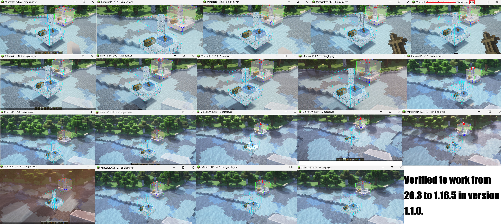
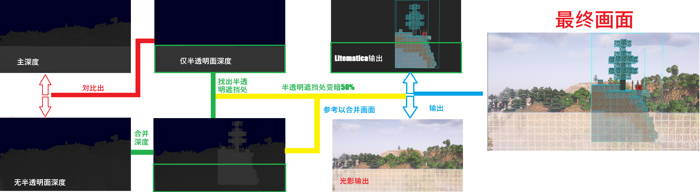

# LitematicaPass

> Note: After being ported from 26.2 to 1.16.5 via AI with stonecutter, the code in this repository is probably quite unreadable. You can check[ the initial commit ](https://github.com/hotpad100c/litematicapass/commit/6faf3cc3970dbde305e0e2b2471ccac746aaa142)to see the cleanest logic and code.

Download : https://github.com/hotpad100c/litematicapass/releases/tag/1.1.0

Verified to work from 26.3 to 1.16.5 in version 1.1.0.
> Try update iris shaders to latest version if something went wrong. Or submit an issue to let me know

* The mod redirects Litematica's rendering to a dedicated RenderTarget and merges it based on depth after Iris finishes shading. This prevents Litematica's rendering results from being influenced by shaders.
* For translucency handling, it derives a depth map containing only translucent faces from Iris's depth map, then darkens any parts occluded by translucent surfaces by 50% to simulate a translucent occlusion effect, achieving the desired functionality while maintaining visual appeal !
* The diagram below was made before running into problem with player hand. To address this: similar to the translucency handling above, the depth map before rendering the hand is captured and compared to identify the area occupied by the arm. The corresponding part of the Litematica output is then discarded, ensuring that the player's hand always appears on top.

